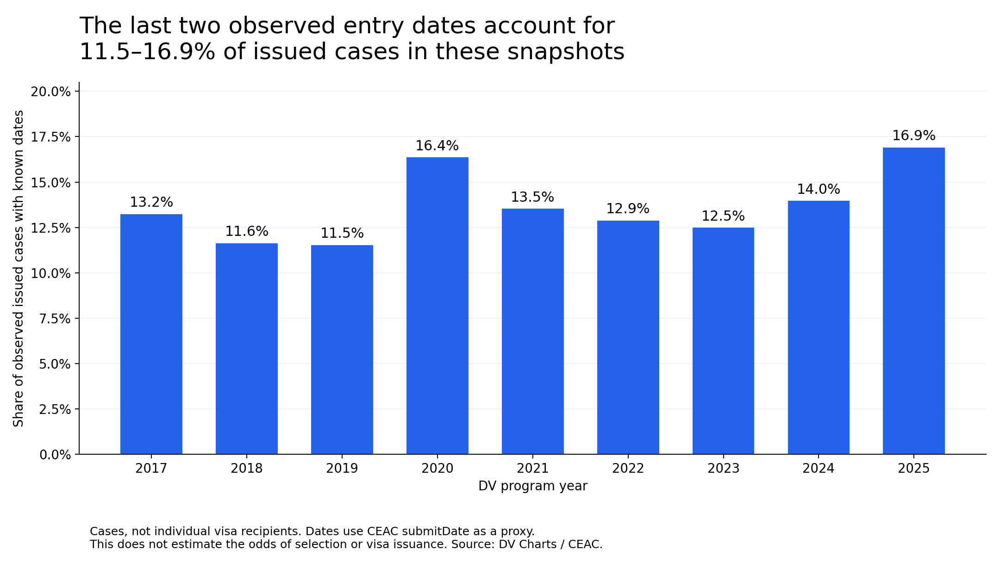
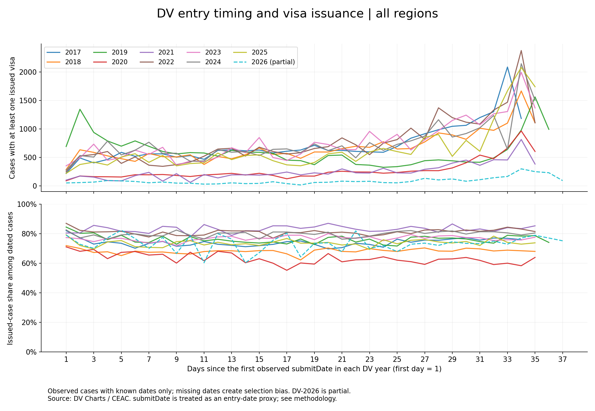

# DV entry timing

**A last-minute entry, a family story, and a missing denominator.**

[Русская версия](README.ru.md) · [Report](docs/REPORT.md) · [Methods](docs/METHODOLOGY.md) · [LinkedIn draft + translation](publication/LINKEDIN.md)

My wife and I entered the Diversity Visa lottery several times. Her entry was selected in DV-2024. That year I kept postponing the submission: time, photos, a slow website. I finally submitted on the last day.

Only after her selection did I discover public CEAC data covering interview scheduling and visa outcomes—and learn that selection does not guarantee a visa. A recurring late-entry peak became the starting point for this exploratory analysis.

## Findings

Across the local DV-2017–2025 snapshots, **11.5–16.9% of observed cases with at least one issued visa and a known `submitDate` fall on the last two observed dates**. In every one of those nine snapshots, the largest daily count is on the penultimate observed date.

For DV-2024: **3,645 of 26,110 cases (13.96%)**. This is a concentration, not a majority.



The data do **not** establish that entering late improves the chance of selection or visa issuance. They lack all entrants by submission day, and dates are missing for many selected cases. The peak is compatible with a surge in entries near the deadline; that explanation is not established by this dataset either.



The top panel counts cases with at least one issued visa. The bottom panel divides them by **observed cases with known dates**. Day 1 is the first observed `submitDate` in each year, not an independently verified opening date. DV-2026 is partial and shown for context only. `submitDate` is an entry-date proxy; its formal definition remains unverified.

## Reproduction

Tested with Python 3.10.11. Run from the repository root:

```bash
python -m venv .venv
# Windows: .venv\Scripts\activate
# macOS/Linux: source .venv/bin/activate
python -m pip install -r requirements.txt
python prepare_publication.py
python -m unittest discover -s tests
```

Committed aggregate CSVs regenerate the English figures and final-two-date table without network access. Raw case-level files and unrelated legacy assets are not included in the publication set.

To reconstruct aggregates from local raw files:

```bash
python download_ceac.py --years 2024 2025 2026 --as-of 2026-11-01
python analyze_ceac.py
python prepare_publication.py --validate-inputs
```

Downloads select the latest published snapshot on or before the cutoff. Legacy 2017–2023 capture dates are unknown: new downloads may not match those inputs. Exact raw reconstruction requires matching hashes. See [methodology](docs/METHODOLOGY.md). The original analysis script also creates Russian figures.

## Contents

- `figures/`: English PNG/SVG figures; [EU comparison](figures/all_years_eu_en.png).
- `outputs/ceac_analysis/`: daily aggregates, coverage, results, validation and provenance.
- `analyze_ceac.py`: raw-data cleaning and aggregation.
- `prepare_publication.py`: English figures, summary and optional independent reconciliation.
- `download_ceac.py`: public snapshot downloads and provenance.
- `docs/`: report and methodology in English and Russian.
- `publication/`: LinkedIn draft and translation; no social post has been published.

Thanks to [Xarthisius / DV Charts](https://dvcharts.xarthisius.xyz/) for collecting CEAC data and maintaining the [archive mirror](https://github.com/dvcharts/dvcharts.github.io). This is an independent analysis. The [official DV-2024 selected-entrants page](https://travel.state.gov/content/travel/en/us-visas/immigrate/diversity-visa-program-entry/dv-2024-selected-entrants.html) explains selection and subsequent processing.

Prepared **November 1, 2026**. Historical descriptions do not identify an optimal entry date or predict future outcomes. Current litigation and registration schedules are outside the research question.
