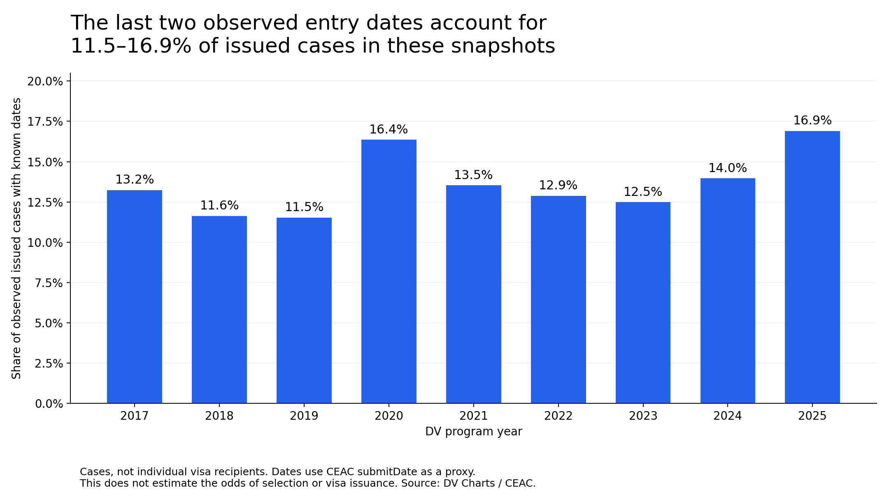
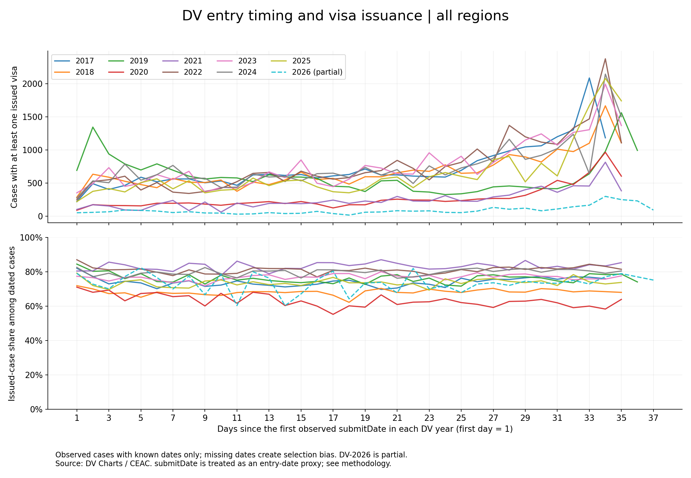

# DV entry timing

**Заявка в последний день, семейная история и недостающий знаменатель.**

[English](README.md) · [Отчёт](docs/REPORT.ru.md) · [Методология](docs/METHODOLOGY.ru.md) · [LinkedIn и перевод](publication/LINKEDIN.md)

Мы с женой несколько раз участвовали в лотерее Diversity Visa. В DV-2024 её анкета была отобрана. В тот год я долго откладывал подачу: не хватало времени, нужно было подготовить фотографии, сайт работал медленно. В итоге подал анкету в последний день.

Уже после отбора я узнал об открытых данных CEAC с информацией о назначении интервью и визовых исходах и о том, что отбор не гарантирует получения визы. Повторяющийся пик поздних заявок стал поводом для анализа.

## Результаты

В локальных снимках DV-2017–2025 последние две наблюдаемые даты дают **11,5–16,9% кейсов с хотя бы одной выданной визой и известным `submitDate`**. Во всех девяти снимках наибольшее дневное число таких кейсов приходится на предпоследнюю наблюдаемую дату.

В DV-2024 это **3 645 из 26 110 кейсов — 13,96%**. Это концентрация, а не большинство.



Данные не устанавливают, что поздняя подача повышает шанс отбора или визы: нет числа всех участников по дням, а у многих отобранных кейсов отсутствуют даты. Пик совместим с ростом числа заявок перед дедлайном, но и эта причина данным набором не доказана.



Сверху — число кейсов с визой, снизу — их доля среди наблюдаемых кейсов с известной датой. День 1 — минимальная `submitDate` года; официальное начало отдельно не проверялось. DV-2026 неполный. Формальное определение `submitDate` у источника не подтверждено; поле используется как приближение даты заявки.

## Воспроизведение

Проверено на Python 3.10.11. Из корня репозитория:

```bash
python -m venv .venv
# Windows: .venv\Scripts\activate
# macOS/Linux: source .venv/bin/activate
python -m pip install -r requirements.txt
python prepare_publication.py
python -m unittest discover -s tests
```

Сохранённые агрегаты позволяют построить английские графики и таблицу последних двух дат без сети. Построчные исходники и посторонние старые файлы в публикацию не входят.

Пересчёт из локальных исходников:

```bash
python download_ceac.py --years 2024 2025 2026 --as-of 2026-11-01
python analyze_ceac.py
python prepare_publication.py --validate-inputs
```

Загрузчик выбирает последний снимок не позднее заданной даты. Для 2017–2023 дата получения старых файлов неизвестна: новая загрузка может отличаться. Для точного воспроизведения нужны совпадающие хеши. Подробности — в методологии.

## Состав

- `figures/`: английские PNG/SVG; [EU отдельно](figures/all_years_eu_en.png).
- `outputs/ceac_analysis/`: агрегаты, покрытие, результаты, проверки и происхождение.
- `analyze_ceac.py`: очистка и расчёты из исходных данных.
- `prepare_publication.py`: английские графики и независимая сверка.
- `download_ceac.py`: загрузка публичных снимков.
- `docs/`: отчёт и методология на двух языках.
- `publication/`: черновик LinkedIn и перевод; сам пост не опубликован.

Благодарность [Xarthisius / DV Charts](https://dvcharts.xarthisius.xyz/) за данные и [архив](https://github.com/dvcharts/dvcharts.github.io). Это независимый анализ. [Официальная страница DV-2024](https://travel.state.gov/content/travel/en/us-visas/immigrate/diversity-visa-program-entry/dv-2024-selected-entrants.html) описывает отбор и дальнейший процесс.

Подготовлено **1 ноября 2026 года**. Работа не определяет лучший день подачи и не прогнозирует будущие результаты. Судебные процессы и текущие сроки регистрации не входят в предмет исследования.
