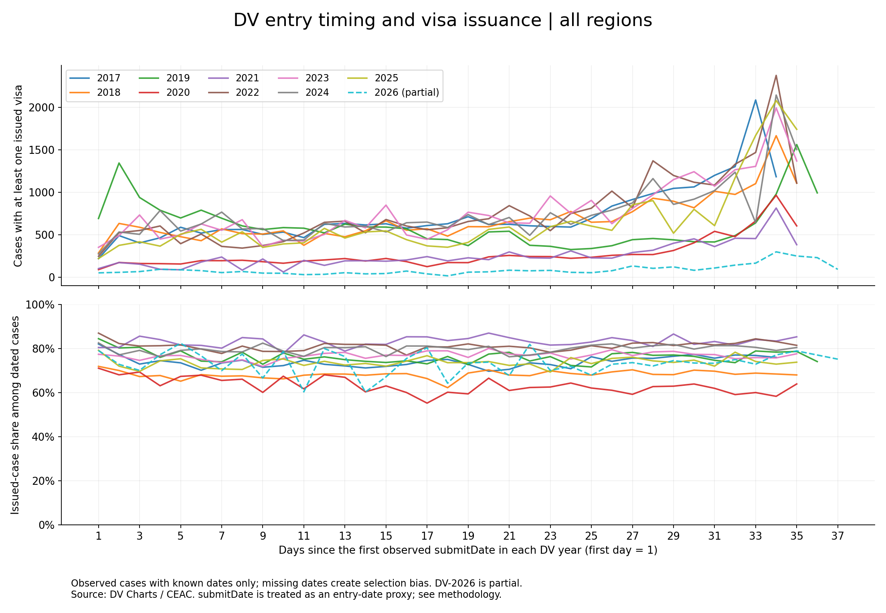

# Entry timing and observed DV visa issuance

[Русский перевод](REPORT.ru.md) · Analysis date: November 1, 2026

## Abstract

An exploratory analysis of public CEAC snapshots finds a recurring late-date peak in the number of cases with at least one issued visa. In nine local DV-2017–2025 snapshots, the last two observed `submitDate` dates account for 11.5–16.9% of such cases with known dates; each snapshot peaks on the penultimate observed day. DV-2024 contributes 3,645 / 26,110 cases (13.96%). These are distributions among observed issued cases, not odds for lottery entrants. Missing daily entry denominators and status-dependent date missingness prevent inference about a benefit of late entry. A partial DV-2026 snapshot is shown separately for context.

## Motivation

The author's wife was selected in DV-2024 after the family had entered several times. The author recalled submitting on the last day after repeated delays involving time, photos and website performance. Discovering public interview-scheduling and visa-status data after selection revealed that lottery selection and visa issuance are different outcomes. Similar-looking curves across years prompted this analysis. The family story motivates the question; it does not validate a timing strategy. No claim is made here about the family's subsequent visa outcome.

## Results

| DV year | Dated cases | Cases with ≥1 issued visa | Of those, last two dates | Share | Peak relative day / final day |
|---|---:|---:|---:|---:|---|
| 2017 | 33,202 | 24,702 | 3,268 | 13.23% | 33 / 34 |
| 2018 | 34,915 | 23,854 | 2,772 | 11.62% | 34 / 35 |
| 2019 | 28,905 | 22,147 | 2,554 | 11.53% | 35 / 36 |
| 2020 | 15,406 | 9,600 | 1,570 | 16.35% | 34 / 35 |
| 2021 | 10,645 | 8,863 | 1,199 | 13.53% | 34 / 35 |
| 2022 | 33,176 | 27,023 | 3,482 | 12.89% | 34 / 35 |
| 2023 | 35,040 | 26,911 | 3,360 | 12.49% | 34 / 35 |
| 2024 | 32,700 | 26,110 | 3,645 | 13.96% | 34 / 35 |
| 2025 | 30,630 | 22,588 | 3,818 | 16.90% | 34 / 35 |
| 2026, partial | 4,453 | 3,313 | 326 | 9.84% | 34 / 37 |

The conspicuous increase in daily counts near the end is not mirrored by a comparably sharp, consistent rise in daily issuance shares among dated cases. This visual observation is not a test proving no association. Cross-year differences in conditional shares must not be interpreted as changes in overall applicant success rates. Legacy 2017–2023 capture dates are unknown.

An EU-only figure is available as a composition check, using the same all-region date origins. It is descriptive, not statistical adjustment for country, consulate or case number.

## Interpretation

The numerator answers: **when did entries associated with observed issued cases appear to have been submitted?** The practical question—**would submitting later increase my chance of a visa?**—needs different data. The date distribution of all entrants is not available in this dataset. Moreover, many selected cases remain without `submitDate`; all NVC cases in the 2024–2025 files lack it. The displayed daily shares are therefore conditional on date availability, not full selectee rates.

For DV-2024 the study has dates for 32,700 / 74,239 observed cases (44.05%); for DV-2025, 30,630 / 70,745 (43.30%). A deadline surge in entry volume could generate a late peak among issued cases even with unchanged odds. Other explanations include composition, processing and data-collection effects. These are possibilities, not identified causes.

The last calendar day may contain fewer registration hours than the penultimate day. Dates are taken from the observed field, whose formal definition remains unverified. Neither a “best day” nor the absence of a timing effect follows from these plots.

## Validation and reproducibility

All ten files passed independent CSV reconciliation of dated-case counts, issued-case counts, status-Issued counts and visa totals against the saved aggregates. Code, checksums, coverage audits, aggregate tables and figure builders accompany the report. Published figures are reproducible from committed aggregates. Exact legacy raw reconstruction is limited by unknown capture dates and unpublished raw files. See [methods](METHODOLOGY.md).

## Conclusion

A recurring late-date concentration is visible in the accessible issued-case data. It is a substantial minority, not a majority, and it does not establish a benefit of delaying entry. The core analytical lesson is to distinguish a distribution among outcomes from an outcome probability among entrants.

## Sources

- [DV Charts](https://dvcharts.xarthisius.xyz/) and its [archive mirror](https://github.com/dvcharts/dvcharts.github.io): CEAC-derived data and source classification.
- [DV-2026 source notes](https://dvcharts.xarthisius.xyz/ceacFY26.html): protected/Dark records and incompleteness.
- [Official DV-2024 selected entrants](https://travel.state.gov/content/travel/en/us-visas/immigrate/diversity-visa-program-entry/dv-2024-selected-entrants.html): selection, entry period and subsequent eligibility/process.
