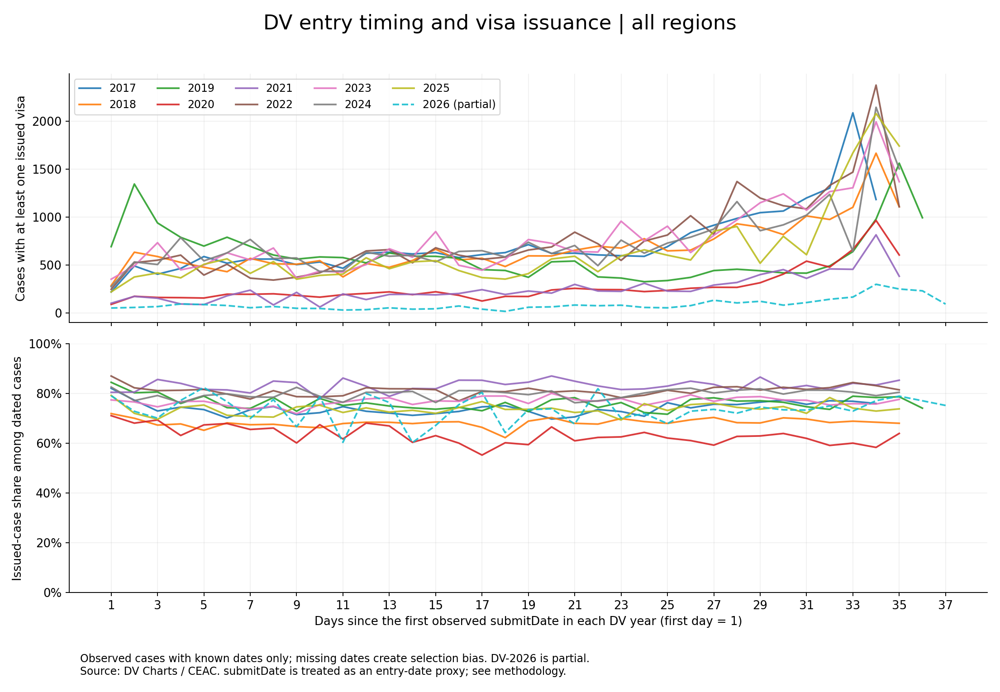

# Дата заявки и наблюдаемая выдача виз DV

[English](REPORT.md) · Дата анализа: 1 ноября 2026 года

## Аннотация

Описательный анализ снимков CEAC обнаруживает повторяющийся пик поздних дат среди кейсов с хотя бы одной выданной визой. В девяти локальных снимках DV-2017–2025 последние две наблюдаемые даты `submitDate` дают 11,5–16,9% таких кейсов с известной датой. Во всех девяти снимках пик приходится на предпоследнюю наблюдаемую дату. Для DV-2024: 3 645 / 26 110, или 13,96%. Это распределение среди наблюдаемых кейсов с выдачей, а не вероятность визы для участника. Нет числа всех заявок по дням, а пропуски дат зависят от статуса. Неполный DV-2026 показан отдельно для контекста.

## Предыстория

Анкета жены автора была отобрана в DV-2024 после нескольких лет участия. Автор вспомнил, что подал анкету в последний день: откладывал, не хватало времени, требовались фотографии, сайт тормозил. После отбора он обнаружил публичные сведения о назначении интервью и статусах виз и понял различие между отбором и выдачей. Повторяющиеся кривые разных лет стали поводом для анализа. История объясняет вопрос, но не подтверждает стратегию. Последующий визовый исход семьи здесь не утверждается.

## Результаты

| Год DV | Кейсы с датой | С ≥1 выданной визой | Из них последние две даты | Доля | День пика / последний день |
|---|---:|---:|---:|---:|---|
| 2017 | 33 202 | 24 702 | 3 268 | 13,23% | 33 / 34 |
| 2018 | 34 915 | 23 854 | 2 772 | 11,62% | 34 / 35 |
| 2019 | 28 905 | 22 147 | 2 554 | 11,53% | 35 / 36 |
| 2020 | 15 406 | 9 600 | 1 570 | 16,35% | 34 / 35 |
| 2021 | 10 645 | 8 863 | 1 199 | 13,53% | 34 / 35 |
| 2022 | 33 176 | 27 023 | 3 482 | 12,89% | 34 / 35 |
| 2023 | 35 040 | 26 911 | 3 360 | 12,49% | 34 / 35 |
| 2024 | 32 700 | 26 110 | 3 645 | 13,96% | 34 / 35 |
| 2025 | 30 630 | 22 588 | 3 818 | 16,90% | 34 / 35 |
| 2026, неполный | 4 453 | 3 313 | 326 | 9,84% | 34 / 37 |

Резкому росту дневного числа кейсов к концу не соответствует такой же резкий и устойчивый рост дневных долей выдачи среди кейсов с датой. Это визуальное наблюдение, а не доказательство отсутствия связи. Различия долей между годами не равны изменениям шанса для любого участника. Даты получения старых снимков 2017–2023 неизвестны.

EU показан дополнительно с теми же началами отсчёта. Этот срез не заменяет корректировку на страну, консульство и номер кейса.

## Интерпретация

Числитель отвечает на вопрос: **когда, судя по полю данных, подавались заявки, связанные с наблюдаемыми выданными кейсами?** Вопрос **повысит ли поздняя подача мой шанс на визу?** требует других данных. Нет распределения всех заявок по датам; у многих отобранных также нет `submitDate`. В файлах 2024–2025 поле отсутствует у всех NVC-кейсов. Дневные доли условны на доступности даты.

Покрытие DV-2024: 32 700 / 74 239 (44,05%); DV-2025: 30 630 / 70 745 (43,30%). Рост числа заявок перед дедлайном мог бы создавать пик среди выданных кейсов при неизменных шансах. Возможны также различия состава, обработки и сбора. Ни одна причина здесь не установлена.

Последний календарный день может содержать меньше часов регистрации, чем предпоследний. Формальное значение поля даты отдельно не подтверждено. Графики не определяют лучший день и не доказывают отсутствие эффекта даты.

## Проверки и воспроизводимость

Десять файлов прошли независимую сверку количества кейсов с датой, с выдачей, статусов Issued и сумм виз с агрегатами. Приложены код, хеши, аудит покрытия и таблицы. Английские графики воспроизводятся от опубликованных агрегатов. Точный пересчёт старых исходников ограничен неизвестными датами захвата и отсутствием публикации построчных файлов. Подробнее — [методология](METHODOLOGY.ru.md).

## Вывод

В доступных данных есть повторяющаяся концентрация кейсов с выдачей у поздних дат. Это существенная меньшая часть, а не большинство. Преимущество откладывания не установлено. Главный аналитический вывод — распределение дат среди исходов нельзя приравнивать к вероятности исхода среди участников.

## Источники

- [DV Charts](https://dvcharts.xarthisius.xyz/) и [архив](https://github.com/dvcharts/dvcharts.github.io): данные CEAC и классификация.
- [Примечания DV-2026](https://dvcharts.xarthisius.xyz/ceacFY26.html): защищённые кейсы и неполнота.
- [Официальная страница DV-2024](https://travel.state.gov/content/travel/en/us-visas/immigrate/diversity-visa-program-entry/dv-2024-selected-entrants.html): отбор, период регистрации и дальнейший процесс.
